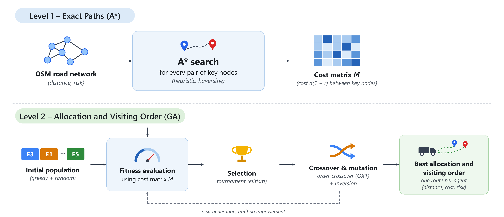
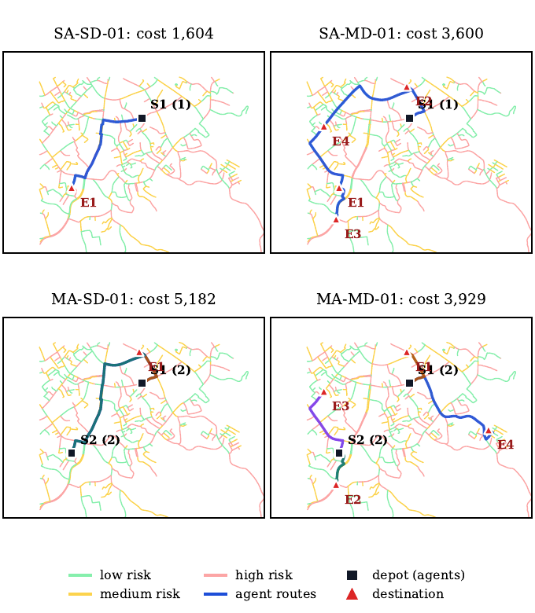
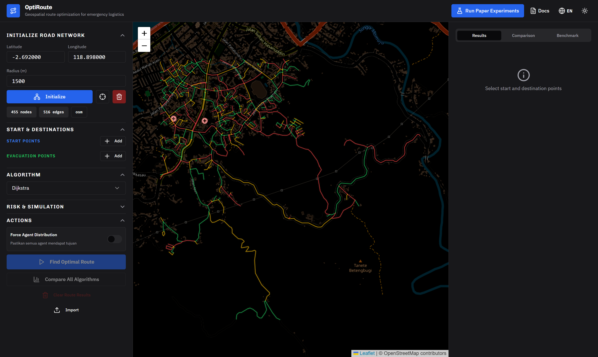
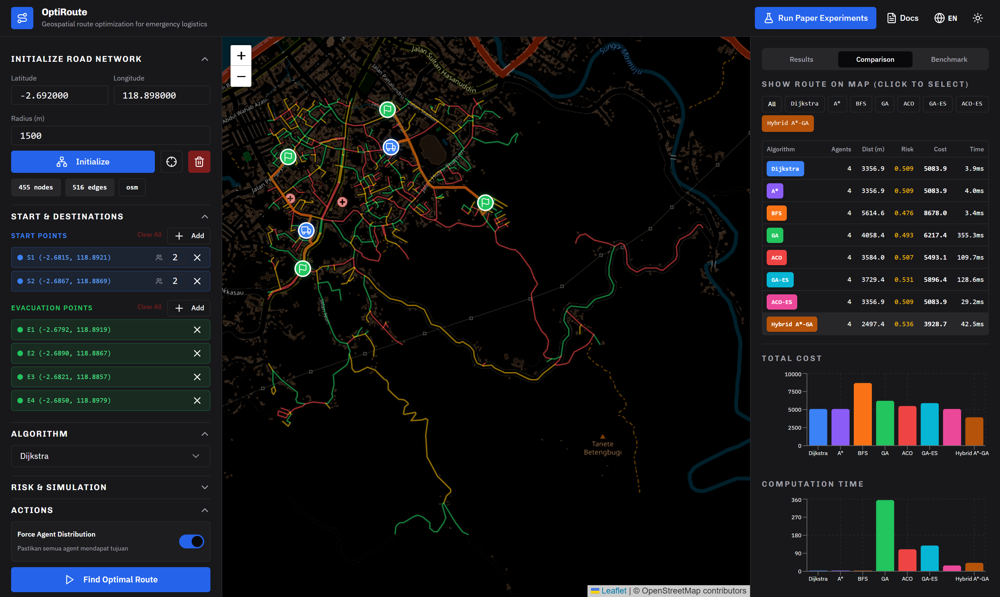
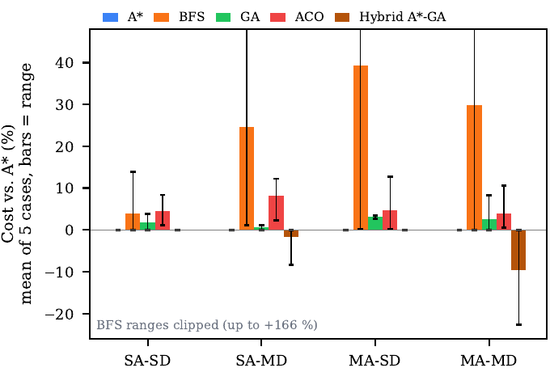
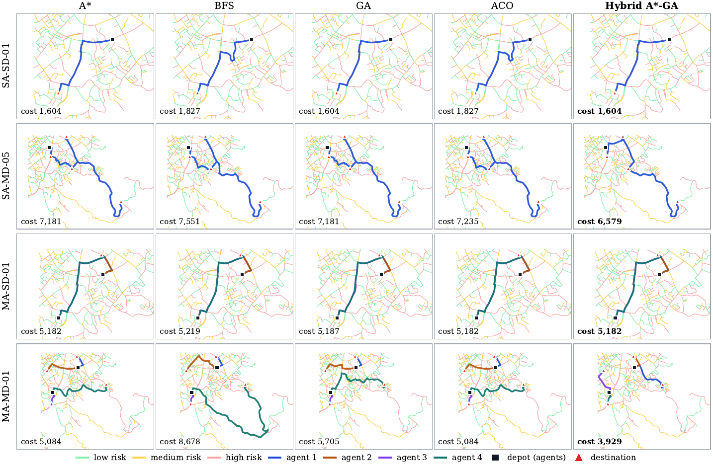
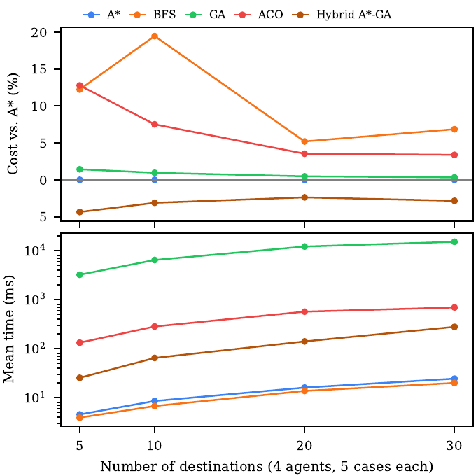

# OptiRoute: Risk-Aware Disaster Relief Routing with a Two-Level Hybrid A\*–GA

[](LICENSE)
[](https://opendatacommons.org/licenses/odbl/1-0/)


This repository contains the web system, source code, frozen dataset, and experiment pipeline of the paper:

> W. Firgiawan, B. Amaliah, A. Saikhu, A. H. Basori, Sulfayanti, and N. Nur, "Risk-Aware Disaster Relief Routing:
> Comparing Exact, Metaheuristic, and Two-Level Hybrid A\*–GA Methods," *2026 10th International Conference on
> Information Technology, Information Systems and Electrical Engineering (ICITISEE)*, IEEE, 2026.

OptiRoute compares **A\***, **Breadth-First Search (BFS)**, a **Genetic Algorithm (GA)**, and **Ant Colony
Optimization (ACO)** under a risk-aware cost, and proposes a **two-level hybrid A\*–GA**. All methods are evaluated
on one OpenStreetMap road network of Mamuju, Indonesia, with **40 documented test cases**.

> **Disclaimer.** This is a simulation study. Only the road geometry comes from OpenStreetMap. Depots, destinations,
> agents, and road risks are simulated and do not describe a real disaster event.



---

## Contents

1. [Overview](#1-overview)
2. [Method](#2-method)
3. [Dataset and test cases](#3-dataset-and-test-cases)
4. [Installation](#4-installation)
5. [Running the application](#5-running-the-application)
6. [Reproducing the experiments](#6-reproducing-the-experiments)
7. [Results](#7-results)
8. [Repository structure](#8-repository-structure)
9. [API reference](#9-api-reference)
10. [How to cite](#10-how-to-cite)
11. [License and acknowledgment](#11-license-and-acknowledgment)

---

## 1. Overview

After a disaster, relief vehicles must reach the affected locations quickly while avoiding hazardous roads.
Shortest-path algorithms such as A\* return an optimal route between two points, but they do not decide **which
vehicle serves which location, and in what order**. This allocation is a multi-depot vehicle routing problem
(MDVRP), which is NP-hard.

OptiRoute addresses both decisions:

| Feature | Description |
|---|---|
| Risk-aware cost | Every road segment has a length *d* (m) and a risk *r* ∈ [0, 1]; its cost is *d*(1 + *r*). |
| Baselines | A\*, BFS, path-level GA, and path-level ACO, combined with a greedy nearest-destination allocation. |
| Proposed method | Two-level hybrid: exact A\* paths (Level 1) and a GA on allocation and visiting order (Level 2). |
| Web application | Interactive map (React + Leaflet) to place depots and destinations, close roads, and compare algorithms. |
| Reproducible study | One frozen network, 40 + 4 test cases, tuned parameters, statistics, and an Excel report generated in one step. |

## 2. Method

### 2.1 Problem and cost function

The road network is an undirected graph *G* = (*V*, *E*). The cost of edge (*i*, *j*) is

```
c_ij = d_ij × (1 + r_ij)
```

Vehicles start at depots and serve the destinations on open routes. The objective is the minimum total cost over all
agent routes. Four metrics are reported for every run:

| Metric | Definition |
|---|---|
| Distance (m) | Total length Σ *d_ij* of the traversed edges |
| Risk exposure | Length-weighted mean risk Σ *d_ij r_ij* / Σ *d_ij* ∈ [0, 1] |
| Cost | Total risk-aware cost Σ *d_ij*(1 + *r_ij*) |
| Time (ms) | Wall-clock time of one complete solution, including the cost matrix |

### 2.2 Algorithms

| Algorithm | Type | Implementation |
|---|---|---|
| A\* | Exact | Haversine heuristic; a lower bound up to the two-decimal rounding of the stored weights (checked by `experiments/verify_heuristic.py`) |
| BFS | Uninformed | Fewest edges; ignores edge cost |
| GA | Metaheuristic (path level) | Chromosome = node path; tournament selection, crossover at a shared node, sub-path mutation; k-shortest-path fallback when fewer than two random walks reach the target (never used) |
| ACO | Metaheuristic (path level) | τ^α η^β with η = 1/cost, elitist deposit, pheromone clipping (floor 0.1, ceiling inversely proportional to the best cost); exact-path fallback when no ant reaches the target (used in 29.9% of the ACO legs) |
| **Hybrid A\*–GA** | **Two-level (proposed)** | Exact A\* paths + GA on allocation and visiting order |

Every baseline combines its path algorithm with the same greedy allocation: destinations are assigned by a greedy
nearest-destination rule on exact path costs, and each leg is then routed by the baseline algorithm. "A\*" in the
results is therefore the **A\*-based greedy baseline**: its paths are optimal, but its allocation and visiting order
are not optimized. The term **verified optimum** is used only for the 15 cases whose optimum was proven by
enumeration. If a baseline returns no path for a leg, the solver uses the exact path (this never occurred). Dijkstra
is also implemented; it was run as a reference method (800 additional runs), returned the same costs as A\* in every
run, and is therefore not reported separately in the paper.

### 2.3 Two-level hybrid A\*–GA

- **Level 1 (exact paths).** A\* computes the least-cost path between every pair of key nodes (depots and
  destinations) and stores the costs in a matrix *M*. For *m* key nodes, this requires *m*(*m* − 1)/2 searches.
- **Level 2 (allocation and visiting order).** A chromosome is a permutation of the destinations with *K* − 1 agent
  separators. The GA uses:
  - fitness = total route cost read from *M*, plus a penalty Ω = 10⁹ per idle agent when mandatory dispatch is
    active and there are at least as many destinations as agents (the makespan weight is 0 in all experiments);
  - a greedy warm start and elitism, which guarantee that the hybrid is never worse than the greedy baseline (this
    is not a proof of global optimality);
  - tournament selection;
  - order crossover (OX1);
  - multi-domain inversion mutation (seven variants from four cut points);
  - population 30, at most 100 generations, and a stop after 30 generations without an improvement larger
    than 10⁻⁶.

Level 2 does not access the road graph. Source code: [`backend/hybrid.py`](backend/hybrid.py); unit tests:
[`backend/tests/test_hybrid.py`](backend/tests/test_hybrid.py).

### 2.4 Tuned parameters

Parameters were selected by random search over 24 configurations on tuning cases that are not used for evaluation
([`dataset/tuned_params.json`](dataset/tuned_params.json)).

| Algorithm | Selected parameters |
|---|---|
| GA | population 100, generations 200, crossover 0.8, mutation 0.2, tournament 3, elitism 5 |
| ACO | ants 10, iterations 50, α = 1.0, β = 1.0, evaporation 0.1 |
| Hybrid A\*–GA | population 30, generations 100, crossover 0.8, mutation 0.5, tournament 3, elitism 4, stall limit 30 |

## 3. Dataset and test cases

**Road network.** Mamuju, West Sulawesi, Indonesia; centre (−2.692, 118.898), radius 1,500 m; 455 nodes and 516 road
segments. Risk values are drawn as *r* ~ U(0, 1) with seed 42. The network is stored in
[`dataset/network/`](dataset/network/), so the application and the experiments run **offline**.

| Group | Test cases | Depots × agents per depot | Destinations | Decision actually tested | Runs per method |
|---|---|---|---|---|---|
| SA-SD | SA-SD-01 … 05 | 1 × 1 | 1 | Path to one destination | 30 |
| SA-MD | SA-MD-01 … 05 | 1 × 1 | 4 | Path and visiting order | 30 |
| MA-SD | MA-SD-01 … 05 | 2 × 2 | 1 | All vehicles go to one shared destination; the allocation GA is skipped | 30 |
| MA-MD | MA-MD-01 … 05 | 2 × 2 | 4 | Mandatory dispatch: each of the four vehicles receives one destination, so only the allocation changes | 30 |
| SC-05 / 10 / 20 / 30 | SC-xx-01 … 05 | 2 × 2 | 5 / 10 / 20 / 30 | Allocation and visiting order (more destinations than vehicles) | 10 |
| TUNE | TUNE-A … D | — | — | Parameter tuning only | — |

SA = single agent, MA = multiple agents, SD = single destination, MD = multiple destinations, SC = scalability.
2 × 2 means two depots with two agents each, i.e., four vehicles.



| Location | Content |
|---|---|
| [`dataset/README.md`](dataset/README.md) | Schema of every dataset file |
| `dataset/test_cases/` | Test cases as JSON, CSV, and GeoJSON; one map per case; importable app sessions |
| [`docs/Dataset_dan_Test_Case.pdf`](docs/Dataset_dan_Test_Case.pdf) | Catalogue of every case: points, map, and results (Indonesian) |
| `dataset/SHA256SUMS` | Checksums of the frozen files |

## 4. Installation

The commands below are given for **Windows PowerShell** (the default terminal of VS Code on Windows) and for
**Linux/macOS (bash)**.

### 4.1 Prerequisites

| Tool | Version | Check |
|---|---|---|
| [Git](https://git-scm.com) | any recent version | `git --version` |
| [Python](https://www.python.org/downloads/) | **3.11** | `python --version` or `py -3.11 --version` |
| [Node.js](https://nodejs.org) | 18 or newer | `node --version` |
| Yarn | 1.22 | `yarn --version` (install with `npm install -g yarn`) |

### 4.2 Clone the repository

```bash
git clone https://github.com/wawanfirgiawanai/aid-path-finder-optimization.git
cd aid-path-finder-optimization
```

All following commands start from this project folder.

### 4.3 Backend (Python virtual environment)

The backend runs in its own virtual environment with pinned packages from
[`backend/requirements.txt`](backend/requirements.txt).

Windows (PowerShell):

```powershell
cd backend
py -3.11 -m venv .venv
.\.venv\Scripts\python.exe -m pip install --upgrade pip
.\.venv\Scripts\python.exe -m pip install -r requirements.txt
Copy-Item .env.example .env
cd ..
```

Linux/macOS:

```bash
cd backend
python3.11 -m venv .venv
.venv/bin/python -m pip install --upgrade pip
.venv/bin/python -m pip install -r requirements.txt
cp .env.example .env
cd ..
```

### 4.4 Frontend (React)

Windows (PowerShell):

```powershell
cd frontend
yarn.cmd install
Copy-Item .env.example .env
cd ..
```

Linux/macOS:

```bash
cd frontend
yarn install
cp .env.example .env
cd ..
```

`frontend/.env` sets `REACT_APP_BACKEND_URL=http://localhost:8001`. On Windows, `yarn.cmd` avoids the PowerShell
error *"running scripts is disabled on this system"*.

### 4.5 Verify the installation

```powershell
.\backend\.venv\Scripts\python.exe -m pytest backend\tests\test_hybrid.py -q      # Windows
```

```bash
backend/.venv/bin/python -m pytest backend/tests/test_hybrid.py -q                # Linux/macOS
```

The expected output is `4 passed`.

## 5. Running the application

The application has two parts that run at the same time in two terminals.

| Part | Address | Ready when the terminal shows |
|---|---|---|
| Backend (FastAPI) | http://127.0.0.1:8001 | `Uvicorn running on http://127.0.0.1:8001` |
| Frontend (React) | http://localhost:3000 | `Compiled successfully!` |

**Terminal 1: backend**

```powershell
cd backend
.\.venv\Scripts\python.exe -m uvicorn server:app --host 127.0.0.1 --port 8001     # Linux/macOS: .venv/bin/python
```

**Terminal 2: frontend**

```powershell
cd frontend
yarn.cmd start                                                                     # Linux/macOS: yarn start
```

Open **http://localhost:3000** in a browser. Stop each part with **Ctrl+C**.

In **VS Code**, open the project folder and press **Ctrl+Shift+B** (task *Run App (Backend + Frontend)*), or open
*Run and Debug* (`Ctrl+Shift+D`), select **OptiRoute: Full App**, and press **F5**.

### 5.1 First steps

1. Press **Initialize** to load the Mamuju network (loaded from `dataset/network/`; no internet access needed).
2. Press **Import** and select `dataset/test_cases/app_sessions/MA-MD-01.json` to load a test case of the paper.
3. Press **Compare All Algorithms** and open the **Comparison** tab.
4. Press **Run Paper Experiments** to reproduce the full study from the browser.

| Network and routes | Algorithm comparison |
|---|---|
|  |  |

### 5.2 Troubleshooting

| Problem | Solution |
|---|---|
| Port 8001 or 3000 is already in use | Close the earlier server, or in PowerShell: `Get-NetTCPConnection -LocalPort 8001,3000 -State Listen \| ForEach-Object { Stop-Process -Id $_.OwningProcess -Force }` |
| `Router.__init__() got an unexpected keyword argument 'on_startup'` | The backend was started with a global Python; use the interpreter in `backend/.venv` |
| Buttons show "Network Error" | The backend is not running, or `frontend/.env` is missing; restart the frontend after creating it |
| **Initialize** is slow for a different location | Areas other than the default Mamuju network are downloaded from the Overpass API and need internet access |

## 6. Reproducing the experiments

**From the web application:** click **Run Paper Experiments** and then **Run all paper experiments**. The pipeline
runs parameter tuning, the 20 main cases, the 20 scalability cases, and the statistical report. Each run is saved in
`experiments/runs/<run-id>/` and never overwrites the published results.

**From the terminal** (project folder, Windows; on Linux/macOS use `backend/.venv/bin/python` and `/`):

```powershell
.\backend\.venv\Scripts\python.exe -W ignore experiments\run_experiments.py --phase all --params-file dataset\tuned_params.json --out experiments\runs\cli --jobs 8
.\backend\.venv\Scripts\python.exe -W ignore experiments\verify_dataset.py --jobs 8
```

| Option | Meaning |
|---|---|
| `--phase` | `all`, `tune`, `main`, `scale`, or `report` |
| `--params-file` | Use the frozen parameters of the paper instead of re-tuning |
| `--jobs N` | Number of worker processes |
| `--out DIR` | Write `results/` and `figures/` to `DIR` |

Costs and distances are identical on every machine because all stochastic runs are seeded; only computation times
differ. `verify_dataset.py` checks every seeded run against the published results.

| Script | Output |
|---|---|
| `experiments/run_experiments.py` | Tuning, main and scalability runs, statistics, figures, Excel workbook |
| `experiments/export_excel.py` | Rebuilds `OptiRoute_Results.xlsx` from existing results |
| `experiments/make_paper_figures.py --astar-only` | Figures of the paper |
| `experiments/make_scenario_maps.py [CASE]` | Route map of one test case |
| `experiments/build_dataset.py` | Test cases, maps, app sessions, and checksums |
| `experiments/verify_dataset.py` | Reproduction check against the published runs |
| `experiments/paper_tables.py` | Tables III–V and the statistics exactly as reported in the paper (five methods) |
| `experiments/verify_heuristic.py` | Rounding check of the stored weights and A\* vs. Dijkstra on all 9,560 key-node pairs |

**Runtime.** Each run is timed as the wall-clock time of one complete solution inside a single-threaded worker
process. The baselines build their allocation matrix with one Dijkstra search per key node and then search every leg
again with the tested algorithm, whereas the hybrid runs one A\* search per pair of key nodes and reuses those paths.
Runtime differences therefore also reflect these implementation choices. New runs record the components
`matrix_ms`, `allocation_ms`, and `routing_ms`, and `results/run_info.json` stores the number of workers and the
machine.

## 7. Results

All numbers below are taken from the paper and can be recomputed from [`experiments/results/`](experiments/results/).
The main scenarios use 5 test cases × 30 runs per algorithm; the scalability scenarios use 5 test cases × 10 runs
per size.

### 7.1 Main scenarios (mean cost over five test cases)

| Scenario | A\* | BFS | GA | ACO | **Hybrid A\*–GA** | Hybrid optimum hits |
|---|---:|---:|---:|---:|---:|---:|
| SA-SD | **2,147.7** | 2,212.5 | 2,177.5 | 2,218.2 | **2,147.7** | 150/150 |
| SA-MD | 6,093.3 | 7,370.2 | 6,132.9 | 6,524.7 | **5,972.9** | 150/150 |
| MA-SD | **10,400.2** | 13,116.0 | 10,717.1 | 10,753.4 | **10,400.2** | — |
| MA-MD | 8,675.1 | 10,754.8 | 8,836.2 | 8,977.0 | **7,997.4** | 150/150 |

Lower cost is better. A\*, BFS, GA, and ACO use the greedy allocation. Optimum hits count the runs (out of 150)
within 0.05 of the verified optimum; no optimum was enumerated for MA-SD, where no allocation decision exists. In
Table III of the paper, **Best** reports the distance, risk exposure, and cost of the minimum-cost run of each test
case (ties: lowest seed), so all three values come from the same run. Run `experiments/paper_tables.py` to rebuild
Tables III–V. Most ACO optimum hits in SA-SD come from its exact-path fallback (125 of its 150 runs there).



### 7.2 Hybrid A\*–GA versus each baseline (40 test cases)

| Hybrid vs. | Better / tie / worse | Mean Δcost (%) | Max. saving (%) | *p* (Wilcoxon, Holm) |
|---|:---:|---:|---:|---:|
| A\* | 22 / 18 / 0 | −3.0 | −22.7 | 1.0 × 10⁻⁵ |
| BFS | 37 / 3 / 0 | −14.1 | −62.4 | 1.3 × 10⁻⁷ |
| GA | 37 / 3 / 0 | −4.3 | −28.6 | 1.3 × 10⁻⁷ |
| ACO | 40 / 0 / 0 | −8.4 | −26.3 | 7.3 × 10⁻¹² |

The five methods differ significantly over the 40 cases (Friedman χ² = 134.0, *p* < 10⁻²⁷). Holm correction is
applied over the four hybrid-versus-baseline comparisons. The Vargha–Delaney effect size is
A₁₂ = P(C_hybrid < C_baseline) + ½ P(C_hybrid = C_baseline), averaged over the cases: 0.88 against GA and 0.89 against
ACO. Because ties count as one half, a hybrid run was strictly cheaper in 76% and 79% of the run pairs.

### 7.3 Scalability (cost relative to A\* / mean time)

| Destinations | A\* time (ms) | GA vs. A\* (%) / ms | ACO vs. A\* (%) / ms | Hybrid vs. A\* (%) / ms |
|---:|---:|---:|---:|---:|
| 5 | 4.6 | +1.4 / 3,233 | +12.8 / 133 | **−4.4** / 26 |
| 10 | 8.6 | +1.0 / 6,452 | +7.5 / 284 | **−3.1** / 65 |
| 20 | 16.1 | +0.5 / 12,152 | +3.5 / 570 | **−2.4** / 141 |
| 30 | 24.5 | +0.3 / 15,175 | +3.4 / 695 | **−2.8** / 279 |

The hybrid improves on the greedy allocation at every size, but the saving does not grow monotonically with the
number of destinations. At 30 destinations, the hybrid is 54 times faster than the path-level GA; this compares
complete implementations and does not mean that the GA accelerates the A\* search.

| Routes of each algorithm | Scalability |
|---|---|
|  |  |

### 7.4 Key findings

- **Exact paths:** A\* returns the optimal path in milliseconds; path-level GA and ACO are slower, less stable, and
  never achieve a lower cost.
- **Optimality:** the hybrid reaches the verified optimum in every run of all 15 verifiable cases (up to four
  destinations), with zero standard deviation in all 20 main cases, and is never worse than any baseline. Optimality
  is not verified for the larger cases.
- **Source of the gain:** the improvement over the A\*-based greedy baseline comes from the allocation and visiting
  order and appears only where such a decision exists (SA-MD, MA-MD, and the scalability cases).
- **Cost versus safety:** the hybrid minimizes total cost, not risk exposure; its exposure is slightly higher in
  SA-MD and MA-MD, so a lower cost does not imply a safer route.
- **Scope:** one static network with simulated risk; the results do not yet support deployment in real disaster
  operations.

### 7.5 Result files

| File | Content |
|---|---|
| `experiments/results/OptiRoute_Results.xlsx` | All results in one workbook (summary, per case, statistics, scalability, tuning, raw runs) |
| `experiments/results/main_runs.csv`, `scale_runs.csv` | Every individual run (including the Dijkstra runs); `covered` counts service visits of all vehicles |
| `experiments/results/fallback_counts.csv` | Fallback use per GA/ACO run (re-run with identical costs) |
| `experiments/results/paper/` | Tables III–V and statistics of the paper (`paper_tables.py`) |
| `experiments/results/table_*.csv`, `stats_*.csv`, `summary.json` | Aggregated tables and statistics of the pipeline (Dijkstra as reference) |
| `experiments/results/optimum.csv` | Verified optimum of the 15 verifiable cases |
| `docs/figures/` | Figures of the paper |

## 8. Repository structure

```
aid-path-finder-optimization/
├── backend/
│   ├── server.py               FastAPI endpoints
│   ├── graph_service.py        road network, risk field, metrics, dataset loader
│   ├── algorithms.py           A*, Dijkstra, BFS, GA, ACO, greedy multi-depot solver
│   ├── hybrid.py               proposed two-level hybrid A*-GA
│   ├── experiment_runner.py    background runner for the experiments dialog
│   ├── tests/                  unit and API tests
│   └── requirements.txt        pinned Python dependencies
├── frontend/                   React + Leaflet web application
├── dataset/
│   ├── network/                frozen Mamuju network (nodes, edges, GeoJSON)
│   ├── test_cases/             40 + 4 test cases, maps, app sessions
│   ├── tuned_params.json       parameters used in the paper
│   └── metadata.json, SHA256SUMS
├── experiments/
│   ├── run_experiments.py      tuning, main, scalability, report
│   ├── verify_dataset.py       reproduction check
│   ├── export_excel.py         Excel workbook of all results
│   ├── make_*.py, build_dataset.py
│   ├── results/                published results of the paper
│   └── figures/                generated figures
├── docs/                       figures, screenshots, test-case catalogue
├── CITATION.cff
└── LICENSE
```

## 9. API reference

Base URL: `http://localhost:8001/api`

| Method | Endpoint | Purpose |
|---|---|---|
| POST | `/graph/init` | Load the network (`lat`, `lng`, `radius`, `seed`, `prefer_cache`) |
| GET | `/graph/data`, `/graph/nearest`, `/graph/summary` | Network GeoJSON, nearest node, network size |
| POST | `/graph/remove-edge`, `/graph/restore-edges`, `/graph/reset` | Road closures and reset |
| POST | `/route/optimize` | Solve with one algorithm (`"algorithm": "hybrid"` for the proposed method) |
| POST | `/route/compare`, `/route/benchmark` | All algorithms once, or *N* runs each |
| POST | `/experiments/run`, `/experiments/cancel` | Start or stop the experiment pipeline |
| GET | `/experiments/status`, `/experiments/results`, `/experiments/figure/{run}/{name}` | Progress, results, figures |
| GET | `/experiments/excel/{run}` | Download the results workbook |

## 10. How to cite

If you use this software, dataset, or results, please cite the paper:

```bibtex
@inproceedings{firgiawan2026riskaware,
  author    = {Firgiawan, Wawan and Amaliah, Bilqis and Saikhu, Ahmad and
               Basori, Ahmad Hoirul and Sulfayanti and Nur, Nahya},
  title     = {Risk-Aware Disaster Relief Routing: Comparing Exact, Metaheuristic,
               and Two-Level Hybrid {A*}--{GA} Methods},
  booktitle = {2026 10th International Conference on Information Technology,
               Information Systems and Electrical Engineering (ICITISEE)},
  address   = {Yogyakarta, Indonesia},
  publisher = {IEEE},
  year      = {2026},
  note      = {Accepted; to appear in IEEE Xplore}
}
```

IEEE style:

> W. Firgiawan, B. Amaliah, A. Saikhu, A. H. Basori, Sulfayanti, and N. Nur, "Risk-aware disaster relief routing:
> Comparing exact, metaheuristic, and two-level hybrid A\*–GA methods," in *Proc. 10th Int. Conf. Information
> Technology, Information Systems and Electrical Engineering (ICITISEE)*, Yogyakarta, Indonesia, 2026.

To cite the software itself, use the **"Cite this repository"** button on GitHub, which reads
[`CITATION.cff`](CITATION.cff). The DOI will be added once the paper is published in IEEE Xplore.

## 11. License and acknowledgment

- **Code:** [MIT License](LICENSE).
- **Dataset:** road geometry © OpenStreetMap contributors, available under the
  [Open Database License (ODbL) 1.0](https://opendatacommons.org/licenses/odbl/1-0/). The derived network, test
  cases, and parameters are released under the same license.

This work was supported by Institut Teknologi Sepuluh Nopember (ITS) and DPPM Diktisaintek.

**Contact:** Wawan Firgiawan, Department of Informatics, Institut Teknologi Sepuluh Nopember, Surabaya, Indonesia.
